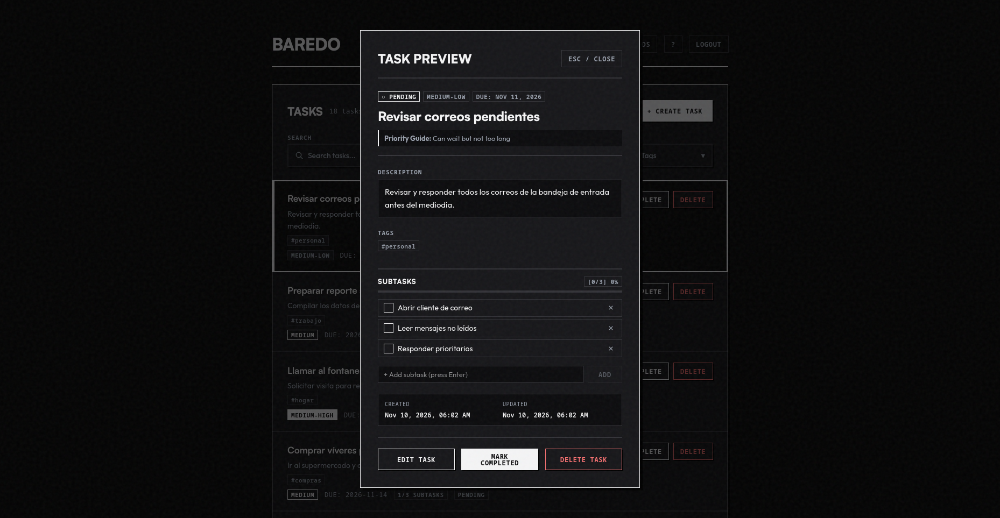
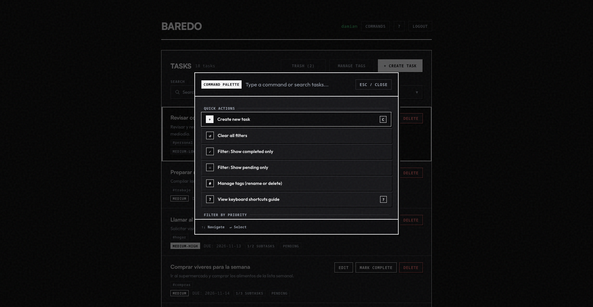
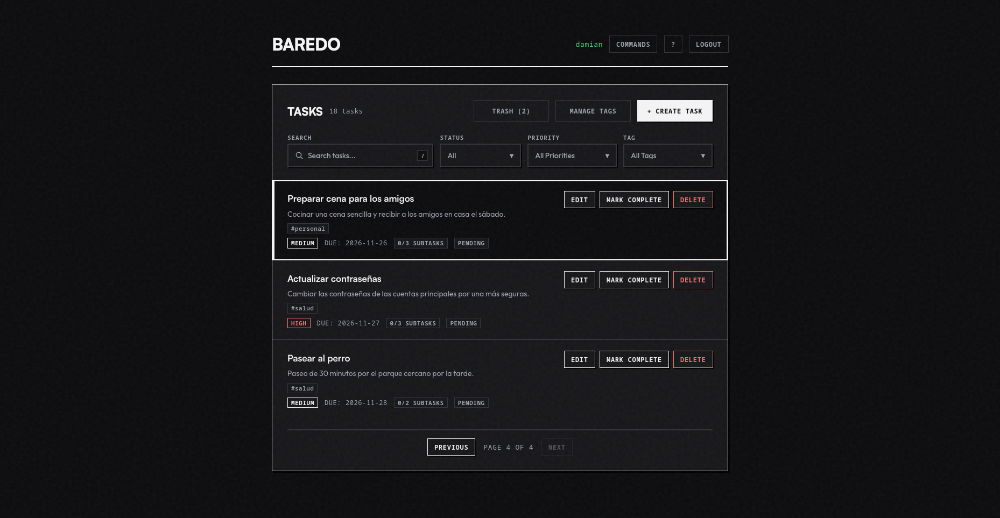

# BareDo

BareDo helps you manage your tasks without touching the mouse. Use your keyboard to move around, open the command palette, and check things off. When you mark a task as done, it disappears instantly — no loading, no waiting. If something goes wrong, the app fixes it automatically and lets you know with a small alert.

Demo in production: [https://baredo.onrender.com](https://baredo.onrender.com)

## Screenshots

| **Task Detail** | **Command Palette** |
| --------------- | ------------------- |
|  |  |

| **Dashboard** |
| --------------- |
|  |

## What it does

BareDo is a task manager built around the keyboard. You can move through your list with `J` and `K`, create tasks with `C`, edit with `E`, delete with `D`, and search everything with `Ctrl+K`. When you check off a task, it disappears immediately — no loading spinner, no waiting. If something goes wrong on the server, the app undoes the change on its own and lets you know.

It works for anyone who wants to get things done quickly.

## Main features

- **Keyboard navigation** — `J`/`K` to move between tasks, `X` or Space to mark or unmark, `Enter` to open details, `E` to edit, `D` to delete, `C` to create, `?` for the shortcut guide.
- **Command Palette** — `Ctrl+K` (or `Cmd+K`) opens a search bar. Use it to find tasks, filter by priority or tags, or jump to a task by typing its title.
- **Instant updates** — When you mark a task as done, it disappears instantly — no loading spinner, no waiting for the server. If something goes wrong, the app undoes the change on its own and lets you know with a small alert.
- **Your session stays saved** — If your connection drops, the app picks back up where you left off without losing anything.

## Tech stack

- **Backend:** Python, Flask, SQLAlchemy, Pydantic, JWT, SQLite (development) / PostgreSQL (production).
- **Frontend:** Preact, Vite, TypeScript, Ky (HTTP client), Zod (schema validation).
- **Testing & Linters:** Pytest + Cov (Backend), Vitest + Testing Library (Frontend), Ruff (Python), Biome (TypeScript/CSS).
- **Package managers:** [uv](https://docs.astral.sh/uv/) (Python), [pnpm](https://pnpm.io/) (Node).

## Getting started

Get the code first:

```bash
git clone https://github.com/MiguelAngel861/BareDo.git
cd BareDo
```

BareDo has two parts that run at the same time: a **backend** (Python) and a **frontend** (the app in your browser). You'll need two terminal windows — one for each.

### 1. Backend

This server stores your tasks and handles logins. Install dependencies, copy the example env file, and start it:

```bash
cd backend
uv sync
cp .env.example .env   # edit values if needed
uv run python wsgi.py   # runs at http://localhost:5000
```

Keep this terminal open.

### 2. Frontend

This is what you interact with in the browser. Open a second terminal:

```bash
cd frontend
pnpm install
cp .env.example .env   # optional: VITE_API_BASE_URL=/api/v1
pnpm dev               # runs at http://localhost:3000
```

While developing, the frontend sends API calls to the backend through Vite's proxy, so you don't need to type the full backend address.

### Docker Compose

```bash
docker compose up --build
```

This starts `db` (Postgres 16 at `localhost:5433`) and `api` (`http://localhost:5000`, hot-reload). The backend runs migrations when it starts. The frontend still runs separately with `pnpm dev`.

In production, the frontend is a static site served on a CDN, and it talks directly to the backend. While you develop, Vite's proxy handles the API calls.

## API

Base URL: `http://localhost:5000/api/v1` locally, `https://baredo-api.onrender.com/api/v1` in production.

**Authentication**

```bash
# Register
curl -X POST http://localhost:5000/api/v1/auth/register \
  -H "Content-Type: application/json" \
  -d '{"username":"miguel","password":"Password123"}'

# Login
curl -X POST http://localhost:5000/api/v1/auth/login \
  -H "Content-Type: application/json" \
  -d '{"username":"miguel","password":"Password123"}'
```

**Tasks** (include `Authorization: Bearer <access_token>`)

```bash
curl "http://localhost:5000/api/v1/tasks?page=1&per_page=5" \
  -H "Authorization: Bearer <access_token>"
```

Available endpoints: `POST /auth/register`, `POST /auth/login`, `POST /auth/refresh`, `GET /auth/me`, `GET/POST /tasks`, `GET/PUT/PATCH/DELETE /tasks/<id>`, `GET /health`.

## Testing

```bash
# Backend (101 tests, coverage ≥ 80%)
cd backend && uv run pytest

# Frontend (69 tests with Vitest + Testing Library)
cd frontend && pnpm test:run
```

## Useful commands

| Command | What it does |
|---|---|
| `uv run python wsgi.py` | Start the local backend |
| `uv run pytest` | Run backend tests |
| `uv run ruff check && uv run ruff format` | Lint and format the backend |
| `pnpm dev` | Start the frontend with hot-reload (port 3000) |
| `pnpm build` | Build the frontend for production |
| `pnpm lint` | Run Biome lint on the frontend |

## Environment variables

**Backend**

| Variable | Default | Description |
|---|---|---|
| `FLASK_ENV` | `development` | Flask environment |
| `DEBUG` | `false` | Debug mode |
| `SECRET_KEY` | dev | Flask session key |
| `DATABASE_URL` | `sqlite:///backend/instance/db.sqlite` | Database connection (`postgres://` and `postgresql://` are normalized to `postgresql+psycopg://`) |
| `JWT_SECRET_KEY` | dev | JWT signing key |
| `CORS_ORIGINS` | localhost dev | Allowed CORS origins (comma-separated, optional when using a reverse proxy) |

**Frontend**

| Variable | Default | Description |
|---|---|---|
| `VITE_API_BASE_URL` | `/api/v1` | API base URL (relative in development, absolute in production) |

## License

[MIT](LICENSE)
