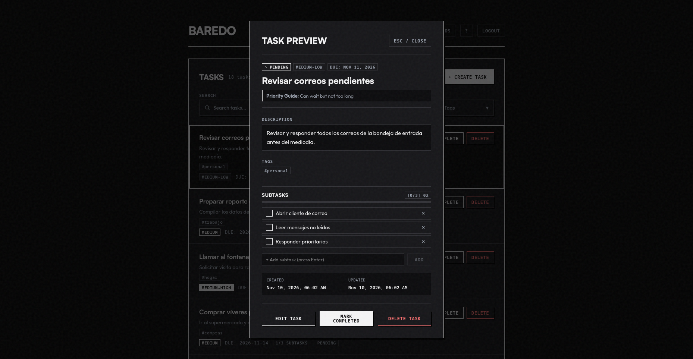
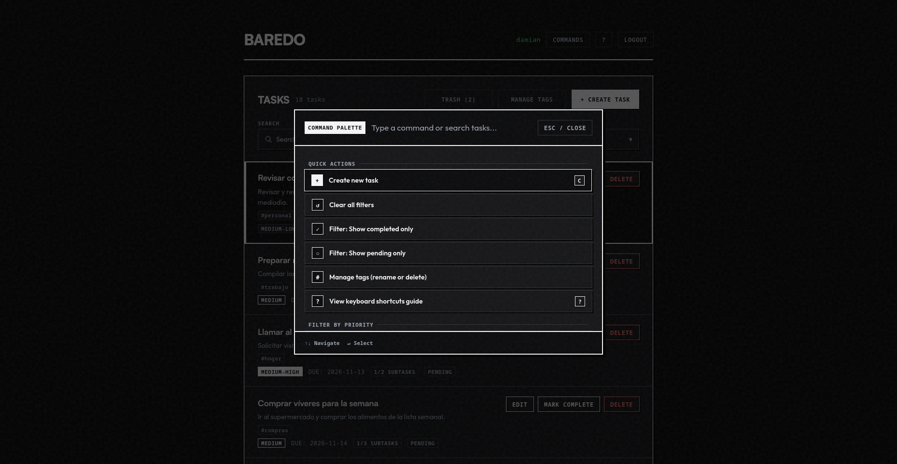
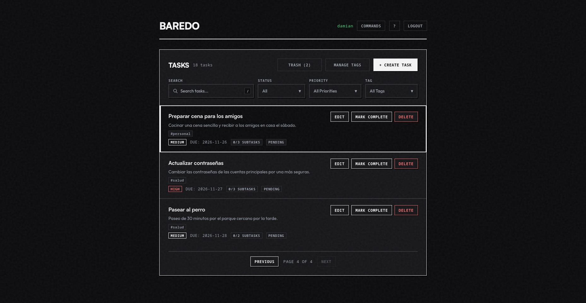

# BareDo

BareDo is a task manager built around the keyboard. Move through your list with `J` and `K`, create tasks with `C`, edit with `E`, delete with `D`, and search everything with `Ctrl+K`. Checking off a task removes it right away, before the server confirms. If the request fails, the app undoes the change on its own and shows a small alert.

Live at: [https://baredo.lunarblade.qzz.io](https://baredo.lunarblade.qzz.io)

## Screenshots

| Task Detail | Command Palette |
|-------------|-----------------|
|  |  |

| Dashboard |
|-----------|
|  |

## Main features

- Keyboard navigation: `X` or Space to mark or unmark, `Enter` to open details, `?` for the shortcut guide.
- Command Palette: `Ctrl+K` (or `Cmd+K`) opens a search bar to find tasks, filter by priority or tags, or jump to a task by typing its title.
- Instant updates: the list updates before the server answers, and rolls back on failure.
- Saved session: if your connection drops, the app picks back up where you left off.

## Tech stack

- Backend: Python, Flask, SQLAlchemy, Pydantic, JWT, SQLite/PostgreSQL.
- Frontend: Preact, Vite, TypeScript, Ky, Zod.
- Testing & linters: 
  - Backend: Pytest, Cov (testing); Ruff (linter).
  - Backend: Vitest, Testing Library, Playwright (testing); Biome (linter).
- Package managers: [uv](https://docs.astral.sh/uv/) (Python), [pnpm](https://pnpm.io/) (Node).

## Architecture

Backend (Flask, layered):

```
backend/app/
├── api/v1/        # HTTP routes and Pydantic schemas
├── services/      # Business logic
├── repositories/  # Data access (one base + one per domain)
├── models/        # Database models
├── core/          # Configuration (DB helpers, extensions, logging, middleware, CORS, pagination)
├── errors/        # Centralized error handling
└── utils/         # Shared helpers
```

Frontend (Preact, organized by slices):

```
frontend/src/
├── app/          # Entry point, router, and layout
├── pages/        # Views 
├── slices/       # One slice per domain: state, api, schemas, types, and UI
├── shared/       # Reusable UI components, HTTP client, auth session, and hooks
└── styles/       # Global CSS tokens and base styles
```

## Prerequisites

| Tool | Version | Why |
|---|---|---|
| Python | 3.14+ | Backend requirement (`requires-python` in `backend/pyproject.toml`) |
| [uv](https://docs.astral.sh/uv/) | latest | Python dependencies and scripts |
| Node | 26 | Frontend (Vite 8) |
| [pnpm](https://pnpm.io/) | 12.18.0 | Frontend package manager (pinned in `frontend/package.json`) |
| Docker | recent | Optional, for the Compose setup (uses an external Postgres database) |

## Getting started

Get the code first:

```bash
git clone https://github.com/MiguelAngel861/BareDo.git
cd BareDo
```

BareDo has two parts that run at the same time: a backend (Python) and a frontend (the app in your browser). You'll need two terminal windows, one for each.

### 1. Backend

This server stores your tasks and handles logins. Install dependencies, copy the example env file, run the migrations, and start it:

```bash
cd backend
uv sync
cp .env.example .env                                   # edit values if needed
uv run python -m flask --app wsgi:app db upgrade head  # creates the schema and seeds priorities
uv run python wsgi.py                                  # runs at http://localhost:5000
```

Keep this terminal open.

### 2. Frontend

This is what you interact with in the browser. Open a second terminal:

```bash
cd frontend
pnpm install
pnpm dev               # runs at http://localhost:3000
```

While developing, the frontend sends API calls to the backend through Vite's proxy, so you don't need to type the full backend address.

### Docker Compose

Compose does not spin up a database container; it expects an external Postgres instance. Copy the root `.env.example` to `.env`, set your secrets and `DATABASE_URL` (use `host.docker.internal` if Postgres runs on your host), then run:

```bash
cp .env.example .env
docker compose up --build
```

The backend runs its migrations automatically on startup via `start.sh`, so your schema is ready out of the box.

Here's what each service does:

- api: The Flask backend served by Gunicorn, bound to `127.0.0.1:5000`.
- frontend: Production build served by Nginx, bound to `127.0.0.1:3000`. It proxies `/api` and `/health` to the backend.

Stop everything with `docker compose down`.

## API

Base URL: `http://localhost:5000/api/v1` (in production, the backend is only reached through the frontend's Nginx proxy and is not exposed directly).

When running the backend locally, the API documents itself using `flask-openapi` and `flask-openapi-swagger`: every route declares its input and output as Pydantic schemas, and those declarations generate an OpenAPI 3.1 spec. That means you can try the whole API from the browser without writing curl: open the Swagger UI at `http://localhost:5000/openapi/swagger`, or read the raw spec at `http://localhost:5000/openapi/openapi.json`. Everything except register, login, and health requires an `Authorization: Bearer <access_token>` header.

### Authentication

Register and login return a token pair (access + refresh) and the user profile. Passwords must be at least 8 characters and include uppercase, lowercase, a number, and a symbol (`@$!%*?&`). Register is rate-limited to 10 attempts per hour, and login to 5 per minute.

```bash
# Register
curl -X POST http://localhost:5000/api/v1/auth/register \
  -H "Content-Type: application/json" \
  -d '{"username":"miguel","password":"Password123!"}'

# Login
curl -X POST http://localhost:5000/api/v1/auth/login \
  -H "Content-Type: application/json" \
  -d '{"username":"miguel","password":"Password123!"}'
```

### Tasks

Lists your tasks with pagination and filters.

```bash
curl "http://localhost:5000/api/v1/tasks?page=1&per_page=5" \
  -H "Authorization: Bearer <access_token>"
```

## Testing

```bash
# Backend: pytest with coverage
cd backend && uv run pytest

# Frontend: Vitest + Testing Library
cd frontend && pnpm test:run

# Frontend: Playwright end-to-end tests (starts backend and frontend automatically)
cd frontend && pnpm test:e2e
```

## Useful commands

| Command | What it does |
|---|---|
| `docker compose up --build` | Start backend and frontend together |
| `docker compose down` | Stop and remove all services |
| `uv run python -m flask --app wsgi:app db upgrade head` | Apply database migrations locally |
| `uv run python wsgi.py` | Start the local backend |
| `uv run pytest` | Run backend tests |
| `uv run ruff check && uv run ruff format` | Lint and format the backend |
| `pnpm dev` | Start the frontend with hot-reload |
| `pnpm build` | Build the frontend for production |
| `pnpm lint` | Run Biome lint on the frontend |
| `pnpm typecheck` | Run TypeScript type checking |
| `pnpm test:e2e` | Run Playwright end-to-end tests |

## Environment variables

Backend

| Variable | Description |
|---|---|
| `FLASK_ENV` | Flask environment (`development` or `production`) |
| `SECRET_KEY` | Key for signing Flask session cookies (required in production) |
| `JWT_SECRET_KEY` | Key for signing login tokens (required in production) |
| `DATABASE_URL` | Database connection string (optional in dev; defaults to local SQLite) |
| `CORS_ORIGINS` | Allowed origins for cross-requests, comma-separated (required in production) |
| `RATELIMIT_STORAGE_URI` | Storage backend for rate limiting, e.g. `memory://` or Redis (required in production) |
| `PORT` | Port Gunicorn binds to in Docker (default `5000`) |
| `MAX_CONTENT_LENGTH` | Optional max request body size in bytes (default `1048576`) |
| `TEST_DATABASE_URL` | Optional database URL for running `pytest` against Postgres instead of in-memory SQLite |

Frontend

| Variable | Description |
|---|---|
| `VITE_API_BASE_URL` | Base URL for the backend API (defaults to `/api/v1`; passed as a build arg in Docker) |

## License

[All Rights Reserved](LICENSE)
